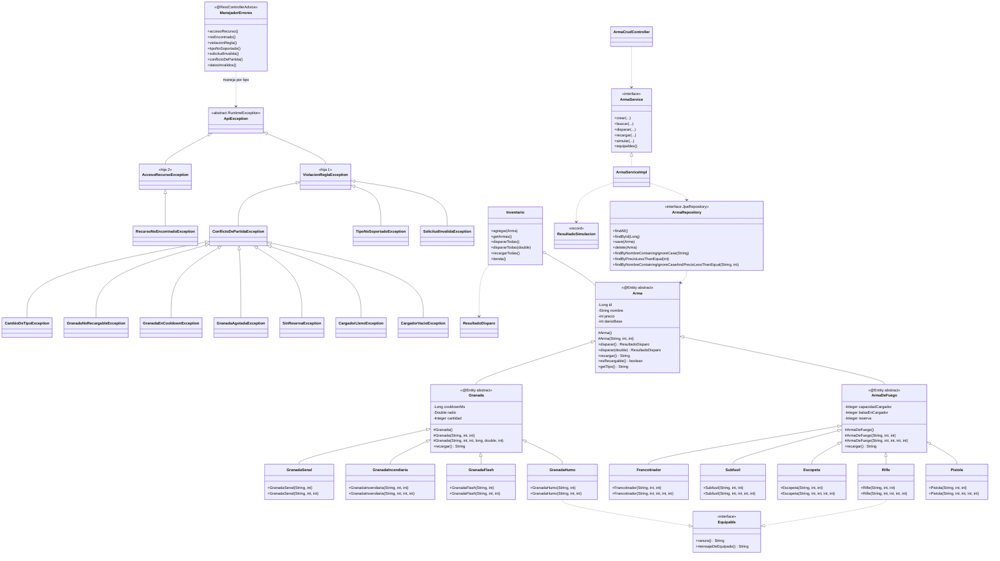

# Taller Git 2026 — Armas de Counter-Strike 2 (POO-08 y POO-09)

Servicio HTTP (Spring Boot, API REST) que modela las armas de **Counter-Strike 2** con
**persistencia en H2 + JPA**. Guarda el estado (munición, reserva y granadas) entre
peticiones, simula dos reglas de juego persistidas y, desde POO-09, expone su OpenAPI y
consume una regla de cada compañero antes de persistir un escenario cruzado.

Materia: Lenguajes de Programación 3 — Taller de Git + POO.
Licencia: Apache License 2.0.

## Entrega

| Qué | Dónde |
|---|---|
| Commit POO-08 corregido | [`54e1e9fe2173fe2310458c916a9665a5f6992193`](https://github.com/luckvani-gif/vricciardi-tallerlp3-2026/commit/54e1e9fe2173fe2310458c916a9665a5f6992193) — entregado el 9/11 a las 21:56, dentro del plazo |
| Commit POO-09 | [`91179e0ba41f336421a02b21e61efc6a8ba08b13`](https://github.com/luckvani-gif/vricciardi-tallerlp3-2026/commit/91179e0ba41f336421a02b21e61efc6a8ba08b13) — *feat: escenario ataque-coordinado con APIs cruzadas POO-09* |
| Código | `src/main/java/py/edu/uc/lp3` |
| Pruebas | `src/test/java` (`./mvnw test`, 34 tests) |
| OpenAPI en vivo | `http://localhost:8081/v3/api-docs` y `http://localhost:8081/swagger-ui.html` |
| Bitácora de IA | [`BITACORA.md`](BITACORA.md) |
| Especificaciones | [`ESPECIFICACIONES.md`](ESPECIFICACIONES.md) |
| Insomnia POO-08 | [`insomnia/CS2-CRUD-Insomnia.json`](insomnia/CS2-CRUD-Insomnia.json) |
| Insomnia POO-09 | [`insomnia/CS2-POO09-Insomnia.json`](insomnia/CS2-POO09-Insomnia.json) |
| Enunciado aplicado | [`docs/entrega-poo-09.md`](docs/entrega-poo-09.md) |
| Diagramas Mermaid | [`docs/POO-09-diagramas.md`](docs/POO-09-diagramas.md) |

Los cambios de corrección posteriores a `91179e0` quedan registrados en el historial de Git;
si se vuelve a enviar la tarea a Classroom, actualizar los enlaces de las tablas con el
último hash (`git rev-parse HEAD`).

## Estado de POO-08 (corrección recibida)

Nota: **20/24** en criterios (rango 17-20) y **8,3/10** en la tarea. Desglose por criterio:
entrega y arranque 3, paquetes 2, ocultamiento 3, herencia 3, constructores 3,
comportamiento observable 3, Git 3 y documentación 0. El código corregido es el del commit
`54e1e9f` (el mismo código que `92d2597` y `d48866d`; los commits posteriores cambiaron
solo documentación).

| Observación | Cierre |
|---|---|
| Paquetes (2/3): `Arma`, `ArmaDeFuego` y `Granada` lanzaban excepciones y tenían reglas de negocio; debían quedar solo con estado y las validaciones vivir en el servicio. | Cerrada: `ReglasJuego` y `ArmaServiceImpl` validan datos, munición, distancia, disparo y recarga antes de mutar; las entidades ya no lanzan excepciones de negocio. Las pruebas que antes ejercitaban esas excepciones desde el dominio ahora las ejercitan desde el servicio. |
| Documentación (0/3): más de tres errores de ortografía en README, documentación, Javadoc y comentarios. | Cerrada: corrección de las faltas señaladas (`parámetros`, `fábrica`, `único`, `aplicación`, `compañeros`, etc.) en README, `docs/`, `BITACORA.md`, `ESPECIFICACIONES.md` y comentarios Java. |

## Cómo arrancar los tres servicios (orden)

1. **A2 y A3 primero.** Sus repositorios no están incluidos acá; se clonan desde los
   enlaces que indican sus dueños y se arrancan con sus propias instrucciones. Sus
   OpenAPI son los de la tabla de abajo; verificar que respondan `/v3/api-docs` antes de
   seguir.
2. **Datos previos.** En A1 crear un rifle con munición y una granada; en A2 crear el arma
   atacante y el objetivo; en A3 tomar una HE sin detonar (no hace falta crearla). La
   colección de Insomnia tiene esos pedidos en el grupo **1. Preparación de datos**.
3. **A1 al final.** Clonar y arrancar este servicio:

```bash
git clone https://github.com/luckvani-gif/vricciardi-tallerlp3-2026.git
cd vricciardi-tallerlp3-2026
./mvnw spring-boot:run
```

A1 escucha en `http://localhost:8081` (puerto fijado en `application.properties`); en la
tabla de roles figura la IP del equipo donde se expone. Consola H2:
`http://localhost:8081/h2-console`, JDBC `jdbc:h2:file:./data/cs2`, usuario `sa`, sin
contraseña. Swagger: `http://localhost:8081/swagger-ui.html` (JSON en `/v3/api-docs`).
Para cambiar el puerto: `./mvnw spring-boot:run -Dspring-boot.run.arguments=--server.port=8082`.

## POO-09 — API cruzada: ataque coordinado

### Quiénes son A1, A2 y A3

| Rol | Estudiante | Servicio | OpenAPI |
|---|---|---|---|
| **A1 (yo)** | luckvani-gif (Vricciardi) | `http://100.95.213.93:8081` (local `http://localhost:8081`) | `http://100.95.213.93:8081/v3/api-docs` |
| **A2** | compañero de CS2 Armas API (su nombre no consta en este repositorio) | `https://desktop-hrm8vjo.tailde75e4.ts.net` | `https://desktop-hrm8vjo.tailde75e4.ts.net/v3/api-docs` |
| **A3** | Ariel Gaona | `https://ariel.tail26e794.ts.net` | `https://ariel.tail26e794.ts.net/v3/api-docs` |

**Hecho del juego que exige las dos validaciones:** un ataque coordinado. El jugador de A1
dispara su rifle, recarga y lanza su humo; antes de registrar la jugada pide a A3 que
valide una explosión HE y a A2 que valide el disparo de su atacante. La jugada se guarda en
el H2 de A1 **solo si los dos compañeros la aceptan** y las reglas locales de A1 son válidas.

### Round robin: reglas de cada dueño

| Dueño | Regla 1 | Regla 2 | Regla consumida por el escenario |
|---|---|---|---|
| **A1** | Disparo consume munición y calcula daño según distancia. | Recarga desde la reserva con control de cargador lleno. | Las dos, vía `ArmaService.simular(fuegoId, granadaId, distancia)`, con persistencia en `jugadas_cruzadas`. |
| **A2** | [`POST /api/armas/{id}/disparar`](https://desktop-hrm8vjo.tailde75e4.ts.net/v3/api-docs) aplica daño y consume munición de su catálogo. | No aparece como operación consumible en el OpenAPI consultado; no se inventa una segunda regla. | Regla 1: `POST /api/armas/{id}/disparar?distancia=10` con `{"objetivoId":2,"distancia":10,"critico":false}`. |
| **A3** | [`POST /api/explosiones/validar`](https://ariel.tail26e794.ts.net/v3/api-docs) calcula daño por radio y empuje sin detonar ni modificar su base. | Tampoco hay una segunda regla verificable en el documento consultado. | Regla 1: `POST /api/explosiones/validar` con `{"granadaId":13,"x":0,"y":0,"z":0}`. |

Las operaciones de los OpenAPI ajenos que se consumen son exactamente esas dos rutas. A1 no
copia clases de los otros dominios: `CompaneroRestClient` arma el JSON con los campos que
piden esos documentos. En A2, `distancia` viaja **en la query y en el cuerpo** porque la
firma consultada expone el parámetro en la URL y el cuerpo lleva `objetivoId`, `distancia`
y `critico`; si el compañero cambia esa firma, se ajusta el cliente sin tocar el escenario.
Un id de atacante inexistente (`999999`) responde 404 y sirve como rechazo determinista.

### Orden de las llamadas

0. **Validaciones locales primero:** A1 verifica ids y tipos (`fuegoId` debe ser
   `ArmaDeFuego`, `granadaId` debe ser `Granada`), cargador con balas, reserva disponible
   para la recarga y granada sin agotar ni en cooldown. Si alguna falla, responde 409/400
   **antes** de llamar a A2 o A3, para no gastar munición ajena por un error propio.
1. **A3 después**, porque su validación no muta su base (HE id 13 sin detonar); si rechaza
   (id 6 detonada), A2 ni se invoca.
2. **A2 luego**, porque su regla sí escribe en el H2 de A2. Si A2 rechaza, A1 no persiste
   nada, pero **no puede revertir** la base de A2: las bases ajenas quedan como el
   compañero las dejó.
3. **A1 al final**, dentro de `@Transactional` en `RegistroJugadaService`: recién con los
   dos `200` ejecuta la simulación local y graba la jugada. Si falla una regla local,
   hay rollback en A1.
4. **A2 acepta y A3 rechaza no ocurre** con este orden: A3 se consulta primero y su
   rechazo corta el flujo. Esa es la razón de poner A3 delante de A2.

### Endpoints nuevos en A1

| Método | Ruta | Respuesta |
|---|---|---|
| POST | `/api/escenarios/ataque-coordinado` | `201` con la jugada persistida y los códigos de A2 y A3. |
| GET | `/api/escenarios/ataque-coordinado` | `200` con todas las jugadas cruzadas guardadas. |

Cuerpo de ejemplo:

```json
{
  "nombre": "Ataque coordinado POO-09",
  "fuegoId": 1,
  "granadaId": 2,
  "distancia": 10,
  "a2AtacanteId": 1,
  "a2ObjetivoId": 2,
  "critico": false,
  "a3GranadaId": 13,
  "x": 0,
  "y": 0,
  "z": 0
}
```

| Situación | Código en A1 | Cuerpo | ¿H2 de A1 cambia? |
|---|---:|---|---|
| A2 y A3 aceptan | 201 | Jugada persistida | Sí: nueva fila en `jugadas_cruzadas` |
| A2 rechaza (id inexistente) | 404 | `RechazoResponse`, `origen: "A2"` | No |
| A3 rechaza (HE detonada) | 409 | `RechazoResponse`, `origen: "A3"` | No; A2 no es llamado |
| Regla local falla | 400 o 409 | `ErrorResponse` con `CargadorVacioException`, `SinReservaException`, `GranadaAgotadaException`, etc.; sin `origen` | No: se valida antes de llamar y hay rollback |
| Compañero sin respuesta | 502 | `RechazoResponse`, `origen: "A2"` o `"A3"` | No |

**Los errores se traducen, no se reenvían tal cual.** El rechazo ajeno se convierte en
`RechazoCompaneroException`, que conserva el código HTTP y el cuerpo crudo del compañero en
`cuerpoCompanero`; el `origen` distingue a A2 de A3. Una regla propia conserva el nombre de
la excepción concreta en `tipo`. Ejemplo guardado en la colección:

```json
{
  "origen": "A2",
  "tipo": "RechazoCompaneroException",
  "codigo": 404,
  "error": "Rechazo de A2 (HTTP 404): {\"status\":404,\"error\":\"Not Found\",\"mensaje\":\"No existe un arma con id 999999\"}",
  "cuerpoCompanero": "{\"status\":404,\"error\":\"Not Found\",\"mensaje\":\"No existe un arma con id 999999\"}"
}
```

### Qué queda en cada base

- **Éxito (201):** una fila nueva en `jugadas_cruzadas` con `nombre`, ids de A1/A2/A3,
  `distancia`, códigos 200 de ambos compañeros, sus respuestas como texto y el resumen de
  la simulación local. En A1 el rifle queda disparado y recargado (por ejemplo `5/14`) y
  la granada pierde una unidad y entra en cooldown.
- **A3 rechaza (409):** cero filas nuevas en A1, munición y granadas de A1 intactas y A2 no
  recibe ningún disparo.
- **A2 rechaza (404):** cero filas nuevas en A1 y estado local intacto; A2 ya aplicó su
  regla antes de responder, y A1 no revierte la base ajena.
- **Regla local inválida (400/409) o compañero sin respuesta (502):** cero filas nuevas y
  estado local intacto; la validación local ocurre antes de cualquier llamada remota.

### Si A2 o A3 no responden

`companeros.timeout` vale `5s` por defecto y se puede cambiar con `COMPANEROS_TIMEOUT`.
`CompaneroRestClient` usa ese valor como timeout de conexión y de lectura. **No hay
reintentos**: un `ResourceAccessException` u otro `RestClientException` se traduce a una
`RespuestaExterna(502, ...)` con cuerpo `{"error":"A3 no disponible","detalle":"..."}`;
el escenario la convierte en `RechazoCompaneroException` con `origen: "A3"`. No se guarda
ninguna respuesta de reintento ni fila en `jugadas_cruzadas`. Los `LOG.debug` del cliente
y del servicio dejan rastro de la URL, el código y el cuerpo recibido. El test
`CompaneroRestClientTest` cubre el 200, el 409 propagado y este 502 con
`MockRestServiceServer`, sin depender de la red.

### Cómo reproducir el rechazo de A3

En la base viva de Ariel, la HE con id `6` ya fue detonada, así que
`POST /api/explosiones/validar` responde 409. Enviar `a3GranadaId: 6` en el cuerpo del
escenario y dejar `a2AtacanteId` con un id válido: A1 debe responder 409 con
`origen: "A3"` y `llamadasA2 = 0` (se ve en los logs de depuración y en el test
`rechazoDeA3NoPersiste`). Si esa base cambió, buscar con `GET /api/armas` de A3 una HE
cuyo estado indique detonada y usar ese id; el comportamiento depende del estado remoto,
no del número `6` en particular. El id `13` es el ejemplo de HE sin detonar para el
camino feliz; también hay que verificarlo en ese `GET` antes de la prueba.

### Configuración externalizada

```bash
A2_BASE_URL=https://desktop-hrm8vjo.tailde75e4.ts.net \
A3_BASE_URL=https://ariel.tail26e794.ts.net \
COMPANEROS_TIMEOUT=5s \
./mvnw spring-boot:run
```

En `application.properties` están los valores por defecto (ahora con A1 en el puerto
8081). Los tests de escenarios usan un `FakeCompaneroClient` con `@Primary` para no
depender de la red; `CompaneroRestClientTest` ejercita el cliente HTTP real contra un
`MockRestServiceServer`, sin abrir conexiones.

### Cómo probarlo con Insomnia

1. Importar [`insomnia/CS2-POO09-Insomnia.json`](insomnia/CS2-POO09-Insomnia.json). El
   `Base Environment POO-09` trae `base_url=http://localhost:8081` y los ids de ejemplo;
   si tus bases están limpias, ejecutá primero el grupo **1. Preparación de datos** para
   crear el rifle y el humo en A1 y copiar sus ids a `fuego_id` y `granada_id`.
2. El grupo **0. OpenAPI** permite verificar los tres documentos antes de llamar. En A2
   crear el arma atacante y el objetivo (`a2_atacante_id`, `a2_objetivo_id`); en A3 elegir
   una HE sin detonar para `a3_granada_id`.
3. **Escenario feliz** → 201 y una fila nueva en `GET Jugadas guardadas`.
4. **Rechazo de A2** (`a2AtacanteId=999999`) → 404 con `origen: "A2"` y la misma cantidad
   de filas.
5. **Rechazo de A3** (`a3GranadaId=6`, si sigue detonada) → 409 con `origen: "A3"`; A2 no
   es invocado y tampoco se persiste nada.
6. Con los compañeros apagados, el mismo pedido feliz devuelve 502 con `origen` del
   compañero que no contestó.

Las respuestas guardadas en la colección son ejemplos de las corridas de referencia; si
las bases de A2 o A3 cambiaron, los ids y los cuerpos pueden diferir. Para una corrida
real, reexportar la respuesta desde Insomnia (Guardar respuesta en el pedido).

Los diagramas de secuencia de cada caso están en
[`docs/POO-09-diagramas.md`](docs/POO-09-diagramas.md) y el enunciado aplicado en
[`docs/entrega-poo-09.md`](docs/entrega-poo-09.md).

## Propiedades de H2 (explicadas)

`src/main/resources/application.properties`:

```properties
server.port=8081                                    # A1 siempre en el mismo puerto
spring.application.name=vricciardi-tallerlp3-2026
spring.datasource.url=jdbc:h2:file:./data/cs2        # base en archivo: persiste entre reinicios
spring.datasource.username=sa                       # usuario por defecto de H2
spring.datasource.password=                         # sin contraseña en desarrollo
spring.jpa.hibernate.ddl-auto=update                # crea/actualiza el esquema desde las entidades
spring.jpa.open-in-view=false                       # el acceso a datos no queda abierto fuera del servicio
spring.h2.console.enabled=true                      # habilita la consola web
spring.h2.console.path=/h2-console                  # ruta de la consola
companeros.a2-base-url=${A2_BASE_URL:https://desktop-hrm8vjo.tailde75e4.ts.net}
companeros.a3-base-url=${A3_BASE_URL:https://ariel.tail26e794.ts.net}
companeros.timeout=${COMPANEROS_TIMEOUT:5s}          # conexión y lectura
```

En tests se usa `src/test/resources/application.properties` con `jdbc:h2:mem:lp3test` y
`create-drop`, así cada corrida empieza con la base limpia.

## Organización de paquetes

```
py.edu.uc.lp3
├── Application.java          # arranque Spring Boot + Springdoc
├── config                    # CompanerosProperties (@ConfigurationProperties)
├── constants                 # ApiPaths, TiposArma
├── domain                    # Arma, ArmaDeFuego, Granada, hijas, JugadaCruzada, Equipable, records
├── exceptions                # ApiException / ViolacionReglaException / AccesoRecursoException / RechazoCompaneroException
├── repository                # ArmaRepository, JugadaCruzadaRepository (interfaces Spring Data JPA)
├── rest/controller           # ArmaCrudController, EscenarioCruzadoController, ManejadorErrores, ArmaController, IndexController
├── rest/dto                  # ArmaRequest, EscenarioCruzadoRequest, JugadaCruzadaResponse
├── service                   # ArmaService, CompaneroClient, EscenarioCruzadoService, RespuestaExterna
└── service/impl              # ArmaServiceImpl, ReglasJuego, CompaneroRestClient, EscenarioCruzadoServiceImpl, RegistroJugadaService
```

Las excepciones viven en `exceptions` dentro de `py.edu.uc.lp3` y las lanza el servicio;
el dominio no importa esa capa para lanzar reglas.

El dominio no conoce HTTP ni valida: expone estado y operaciones. La entrada HTTP no arma
munición ni decide reglas: traduce JSON a mensajes y delega en el servicio.

## Tres clases del modelado (persistidas)

Se persiste la familia con `@Inheritance(strategy = InheritanceType.SINGLE_TABLE)` y
`@DiscriminatorColumn(name = "tipo_arma")`:

1. **`Arma`** — clase base, `@Entity`, abstracta. Tiene `id` generado, nombre, precio,
   daño y el Template Method `disparar()`.
2. **`ArmaDeFuego`** — hija 1, abstracta. Generaliza cargador, balas y reserva; deja
   final la lógica de consumo y recarga. Sus hijas concretas son `Pistola`, `Subfusil`,
   `Rifle`, `Escopeta` y `Francotirador`.
3. **`Granada`** — hija 2, abstracta. Generaliza cooldown, radio y cantidad. Sus hijas
   concretas son `GranadaHumo`, `GranadaFlash`, `GranadaIncendiaria` y `GranadaSenal`.

Las dos ramas son independientes y cumplen «es un» respecto de `Arma`. El método
abstracto de POO-06 sigue existiendo (`getTipo()`, `getEstado()`, `recargar()` y los
pasos `motivoBloqueo()`, `consumirUso()`, `calcularDanio()`, `describirEfecto()`), y cada
hija lo sobreescribe. Las hijas también ofrecen **constructor simple** y **constructor
sobrecargado**; los dos dejan el objeto en un estado legal.

JPA exige un constructor sin argumentos. Se resolvió declarándolo `protected`: JPA lo
usa para reconstruir la entidad, pero el resto del programa no puede crear un arma
vacía. Las validaciones no viven en el constructor: las hace `ReglasJuego` en el servicio
antes de crear o modificar el arma. Los constructores de negocio son los públicos.

## Interfaz de dominio (POO-07)

`py.edu.uc.lp3.domain.Equipable` declara `ranura()` y un mensaje por defecto
`mensajeDeEquipado()`. La implementan **dos clases de familias distintas**: `Rifle`
(`ArmaDeFuego`) y `GranadaHumo` (`Granada`). El endpoint `GET /api/armas/equipables`
trabaja con `List<Equipable>`, lee desde el repositorio y muestra el mensaje de forma
polimórfica.

## Repositorio Spring Data

`ArmaRepository extends JpaRepository<Arma, Long>` es una **interfaz**: Spring Data
genera la implementación. Mensajes de consulta declarados (no implementados a mano):

```java
List<Arma> findByNombreContainingIgnoreCase(String nombre);
List<Arma> findByPrecioLessThanEqual(int precio);
List<Arma> findByNombreContainingIgnoreCaseAndPrecioLessThanEqual(String nombre, int precio);
```

Se usan en `GET /api/armas?nombre=AK`, `GET /api/armas?precioMax=500` y en la
combinación de ambos filtros.

## CRUD REST completo

| Método | Ruta | Descripción |
|---|---|---|
| POST | `/api/armas` | Crear desde JSON con discriminador `tipo`. **201** + `id`. |
| GET | `/api/armas` | Listar lo persistido; filtros opcionales `nombre` y `precioMax`. |
| GET | `/api/armas/{id}` | Obtener uno. **404** si no existe. |
| PUT | `/api/armas/{id}` | Actualizar nombre, precio y daño. No permite cambiar el tipo → **409**. |
| DELETE | `/api/armas/{id}` | Borrado físico. **204**. **404** si no existe. |
| POST | `/api/armas/{id}/disparar?distancia=10` | Regla 1: daño/consumo persistido. |
| POST | `/api/armas/{id}/recargar` | Regla 2: carga de munición persistida. |
| POST | `/api/armas/simular?fuegoId=1&granadaId=2&distancia=10` | Simulación con las tres clases. |
| GET | `/api/armas/equipables` | Endpoint de la interfaz `Equipable`. |
| GET | `/` | Servicio vivo y lista de endpoints. |

**Identidad:** el `id` lo genera la base con `@GeneratedValue(strategy = IDENTITY)`; el
JSON de creación lo omite. El número de la URL es ese identificador persistido, no un
índice de una lista del controller.

**Jackson y el subtipo:** al crear, `ArmaRequest` recibe un campo `tipo` (`rifle`,
`humo`, …) que el servicio traduce a un constructor concreto. Al leer, el JSON devuelve
`tipo` con ese mismo código estable y `nombreTipo` con el nombre legible de la hija
(`Rifle`, `Granada de humo`, …). Así el `tipo` que devuelve un `GET` se puede copiar a un
`PUT` sin provocar un 409. Se eligió un DTO con discriminador en lugar de `@JsonTypeInfo`
porque así el JSON público no queda atado a nombres de clases Java ni al constructor
vacío de JPA; el subtipo se decide en el dominio y el contrato HTTP queda estable.

## Dos reglas de negocio y simulación persistida

- **Regla 1 — Daño y consumo de munición:** al disparar un arma de fuego se consume una
  bala del cargador y el daño depende de la distancia (`calcularDanio` polimórfico). El
  **servicio** valida distancia, balas, granadas y cooldown en `ReglasJuego`; si la regla
  falla lanza `CargadorVacioException`, `GranadaAgotadaException` o
  `GranadaEnCooldownException` (409) sin guardar un estado ilegal. La entidad solo
  devuelve `ResultadoDisparo.fallido` cuando no puede consumir; no lanza excepciones.
- **Regla 2 — Carga de munición con control de reserva:** `ReglasJuego.validarRecarga`
  comprueba el estado antes de llamar a `ArmaDeFuego.recargar()`, que solo completa lo que
  falta y descuenta de la reserva. Si el cargador está lleno o no hay reserva, el
  **servicio** lanza `CargadorLlenoException` o `SinReservaException` (409). Las granadas
  no son recargables: el servicio lanza `GranadaNoRecargableException` (409).

La simulación `POST /api/armas/simular` involucra las **tres clases**: recibe el id de un
`ArmaDeFuego` y el id de una `Granada`, dispara, recarga y lanza la granada. Todo se
guarda en H2 en una sola transacción: si una regla falla, no queda un estado a medias.
Un `GET /api/armas` posterior muestra el estado ya persistido.

## Jerarquía de excepciones y handlers

```text
ApiException (base, abstracta, RuntimeException)
├── ViolacionReglaException (hija 1)
│   ├── SolicitudInvalidaException      -> 400
│   ├── TipoNoSoportadoException        -> 400
│   └── ConflictoDePartidaException     -> 409
│       ├── CargadorVacioException
│       ├── CargadorLlenoException
│       ├── SinReservaException
│       ├── GranadaAgotadaException
│       ├── GranadaEnCooldownException
│       ├── GranadaNoRecargableException
│       └── CambioDeTipoException
└── AccesoRecursoException (hija 2)
    └── RecursoNoEncontradoException    -> 404
```

Las hojas de `ConflictoDePartidaException` heredan el 409 y el cuerpo conserva el nombre
concreto de la regla del juego que falló.

Se usan excepciones **no comprobadas** (`RuntimeException`): las reglas del dominio no
obligan a llenar la firma de todos los métodos con `throws`, y el `@RestControllerAdvice`
las traduce a HTTP en un solo lugar. Se reserva una excepción comprobada para errores
recuperables por el llamador; acá el llamador es HTTP, así que el handler es el punto de
traducción.

`ManejadorErrores` tiene un `@ExceptionHandler` **por tipo**. La respuesta común es:

```json
{ "tipo": "CargadorLlenoException", "codigo": 409, "error": "El cargador ya está lleno" }
```

Con `tipo` y `codigo`, el cliente distingue la regla concreta aunque el mensaje cambie.
`ReglasJuego.validarDatos` lanza `IllegalArgumentException` para datos inválidos antes de
crear la entidad; el handler la traduce a **400** y la colección muestra ese caso. Así el
dominio queda sin validaciones ni excepciones de negocio, como pide la corrección de POO-08.

## Colección de Insomnia

Importar `insomnia/CS2-CRUD-Insomnia.json` (Insomnia → Import → From File). El entorno
`Base Environment` define:

- `base_url`: `http://localhost:8081`
- `tipo`: `rifle` (código que devuelve el GET y acepta el PUT)
- `arma_id`: id del arma de fuego creada
- `granada_id`: id de la granada creada
- `arma_vacia_id`: id del rifle con cargador 1 y reserva 0
- `arma_llena_id`: id del rifle con cargador lleno

**Orden sugerido:**

1. `GET /` — el servicio está vivo.
2. `POST /api/armas` (rifle) — 201; copiar el `id` en `arma_id`.
3. `POST /api/armas` (humo) — 201; copiar el `id` en `granada_id`.
4. `GET /api/armas` y `GET /api/armas/{{ _.arma_id }}` — el recurso aparece.
5. `PUT /api/armas/{{ _.arma_id }}` — el campo cambia y sigue después de otro `GET`.
6. `POST /api/armas/simular` — disparo + recarga + granada; luego `GET /api/armas`.
7. `GET /api/armas/equipables` — endpoint de la interfaz.
8. Probar los errores: precio negativo, tipo desconocido, cargador incompleto, preparar
   un rifle sin reserva (gastar su única bala, disparar sin balas, recargar sin
   reserva), preparar un rifle lleno (recargarlo), cambio de tipo, recargar granada,
   granada agotada después de simular e id inexistente. La colección **no** crece con
   basura.
9. `DELETE /api/armas/{{ _.arma_id }}` — 204; el `GET` posterior es 404.

El export incluye `"scope": "collection"` en el workspace y el `Base Environment` cuelga
de ese workspace, así Insomnia lo importa como colección y no como diseño. La colección
incluye pedidos para las dos hijas de la jerarquía y para los conflictos de partida más
representativos (cargador vacío, cargador lleno, sin reserva, granada agotada, granada no
recargable y cambio de tipo).

## Diagrama Mermaid



**Cómo leer el diagrama:**

- **Herencia:** flechas `Arma <|-- ArmaDeFuego` y `Arma <|-- Granada`; las concretas
  heredan de esas dos ramas.
- **Implementación de interfaz:** `Rifle ..|> Equipable` y `GranadaHumo ..|> Equipable`.
- **Constructores y sobrecarga:** `Arma`, `ArmaDeFuego`, `Granada` y cada clase concreta
  muestran constructor simple y sobrecargado; `Arma` muestra `disparar()` y
  `disparar(double)`, e `Inventario` muestra `dispararTodas()` y `dispararTodas(double)`.
- **Uso del repositorio:** `ArmaServiceImpl ..> ArmaRepository`; el controller no toca
  la base.
- **Jerarquía de excepciones:** `ApiException` con las dos hijas y las excepciones de
  regla; `ManejadorErrores` las atiende por tipo.

## Sobrecarga y sobreescritura (rúbrica)

**Sobrecarga** — mismo nombre, distinta lista de argumentos:

- Constructores simples y sobrecargados en `Pistola`, `Subfusil`, `Rifle`, `Escopeta`,
  `Francotirador`, `GranadaHumo`, `GranadaFlash`, `GranadaIncendiaria` y `GranadaSenal`.
- `Arma.disparar()` y `Arma.disparar(double)`.
- `Inventario.dispararTodas()` y `Inventario.dispararTodas(double)`.

**Sobreescritura** — misma firma, implementación propia en la hija:

- `getTipo()`, `getEstado()`, `recargar()`, `motivoBloqueo()`, `consumirUso()`,
  `calcularDanio()`, `describirEfecto()` y `detalleTienda()` en cada rama/hija.
- `ranura()` y `mensajeDeEquipado()` en las clases que implementan `Equipable`.

## Pruebas

```bash
./mvnw test
```

**Resultado:** `BUILD SUCCESS` con **34 tests**: 6 de CRUD/integración, 11 de
sobrecarga/sobreescritura, 4 de reglas (consumo en dominio y excepciones desde el servicio),
4 de granadas, 1 de arranque, 5 de `EscenarioCruzadoTest` (feliz, rechazo de A2, rechazo de
A3, fallo local sin llamar a los compañeros y OpenAPI publicado) y 3 de
`CompaneroRestClientTest` con `MockRestServiceServer` (200, rechazo 409 y 502 por timeout).
Los tests de escenarios falsifican al cliente con `@Primary` y los del cliente real usan un
servidor simulado, así que la suite no llama a la red. Incluyen además el POST ilegal sin
basura, un código por cada excepción y la simulación de las tres clases.

## Respuestas a «Qué hay que pensar»

- **Recurso y verbo:** el sustantivo es `armas` (`/api/armas`). El verbo HTTP dice la
  operación; la URL no lleva verbos (`/crear`, `/borrar`).
- **Identidad:** `id` con `@GeneratedValue`; lo asigna la base. El JSON de creación lo
  omite y el de lectura lo devuelve.
- **Herencia y tablas:** `SINGLE_TABLE` con discriminador `tipo_arma`. Toda la familia
  vive en una tabla; JPA instancia la clase correcta. Se distingue el subtipo en el JSON
  por el campo `tipo` (ver sección de Jackson).
- **Interfaz y repositorio:** `ArmaRepository` es una interfaz generada por Spring Data;
  el servicio depende del tipo, no de una implementación. `Equipable` es la interfaz de
  dominio y la usa `GET /api/armas/equipables` con objetos de familias distintas.
- **Protocolo del dominio:** `Equipable`; lo usan `Rifle` y `GranadaHumo` y el endpoint
  `GET /api/armas/equipables`. Sí puede hablar con familias distintas porque el
  controller solo ve `List<Equipable>`.
- **Ocultamiento:** los atributos son privados y no hay setters de munición; las reglas
  numéricas las valida `ReglasJuego` en el servicio antes de que el dominio mute su
  estado. Un `POST` ilegal responde 400/409 y la colección queda igual (hay prueba de
  integración).
- **PUT y PATCH:** se usa `PUT`: reemplaza los datos editables (nombre, precio, daño).
  Un campo omitido obligatorio responde 400; el `tipo` persistido no se puede cambiar
  (409). La munición no se toca por `PUT`.
- **DELETE:** borrado físico con `delete`; responde **204**. El verbo HTTP habla con el
  mensaje del servicio `eliminar`, que primero busca y lanza 404 si no existe.
- **Dos reglas:** (1) daño/consumo de munición al disparar; (2) carga desde la reserva al
  recargar. Cambian el estado de más de un objeto en la simulación (`ArmaDeFuego` y
  `Granada`). El recurso HTTP es `POST /api/armas/simular`; un `GET /api/armas` posterior
  muestra el resultado persistido.
- **Excepciones:** `ApiException` (base), `ViolacionReglaException` (regla incumplida) y
  `AccesoRecursoException` (recurso inexistente). Dentro de las reglas,
  `ConflictoDePartidaException` agrupa los estados de partida (409) con nombres del
  juego: `CargadorVacioException`, `CargadorLlenoException`, `SinReservaException`,
  `GranadaAgotadaException`, `GranadaEnCooldownException`,
  `GranadaNoRecargableException` y `CambioDeTipoException`. El JSON de error lleva
  `tipo`, `codigo` y `error`.
- **¿Quién lanza la excepción?** `ReglasJuego` y `ArmaServiceImpl` validan y lanzan;
  el dominio solo cambia estado y devuelve un `ResultadoDisparo` fallido. El controller
  no lanza reglas y el handler solo traduce a HTTP.
- **Si mañana cambia H2 por otra base:** se tocan `pom.xml` (driver) y
  `application.properties` (URL/dialecto). No cambian las entidades, el repositorio, el
  servicio, los controllers, las excepciones ni la colección de Insomnia.

## Cómo se relaciona con la rúbrica

| Criterio | Evidencia en este repositorio |
|---|---|
| 1. Entrega y arranque | Repo público, `./mvnw spring-boot:run`, README, `BITACORA.md`, `ESPECIFICACIONES.md`, commit enlazado. |
| 2. Paquetes | `domain`, `repository`, `rest.controller`, `service.impl`, `exceptions` separados. |
| 3. Ocultamiento | Campos privados sin setters de munición, validaciones en `ReglasJuego`/servicio, POST ilegal sin basura. |
| 4. Herencia | `Arma` → `ArmaDeFuego`/`Granada`, métodos sobreescritos, excepciones base + dos hijas con handler. |
| 5. Constructores y sobrecarga | Constructores simples/sobrecargados, `disparar()`/`disparar(double)`, `dispararTodas()`/`dispararTodas(double)`. |
| 6. Observable | CRUD, H2 en archivo, dos reglas, simulación con las tres clases, handlers por tipo, Insomnia. |
| 7. Git | Commits por dependencias/entidades/repositorio/controller/reglas/excepciones/Insomnia/README. |
| 8. Documentación y defensa | README al día, diagrama Mermaid, sobrecarga/sobreescritura explicadas, bitácora con modelo y prompts, ortografía corregida. |
| 9. APIs cruzadas (POO-09) | OpenAPI publicado con Springdoc, cliente A2/A3 externalizable, rechazos propagados con `origen`, persistencia transaccional de `jugadas_cruzadas`, Insomnia y diagramas propios. |
