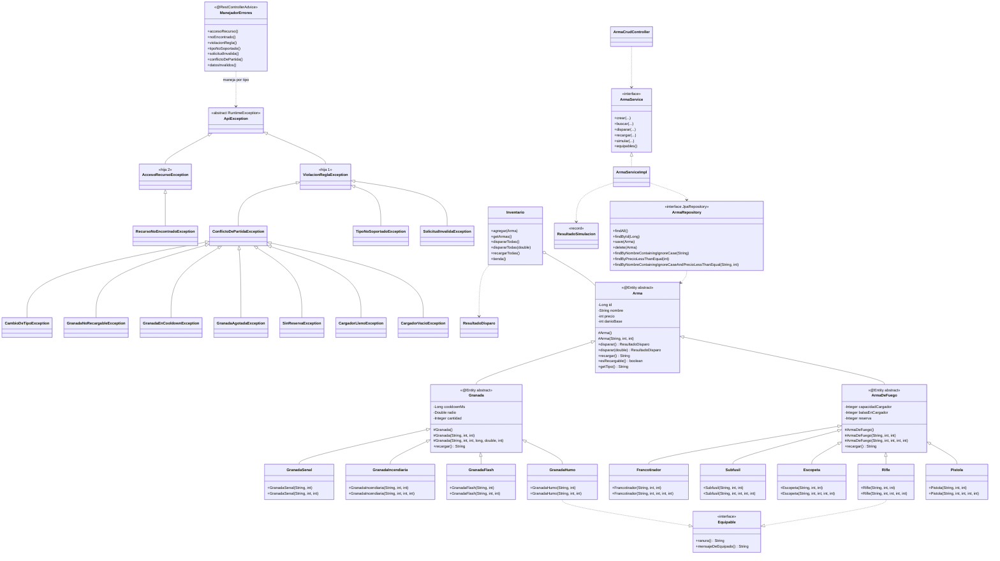

# Taller Git 2026 — Armas de Counter-Strike 2 (POO-08)

Servicio HTTP (Spring Boot, API REST) que modela las armas de **Counter-Strike 2** con
**persistencia en H2 + JPA**. Guarda el estado (munición, reserva y granadas) entre
peticiones y simula dos reglas de juego persistidas.

Materia: Lenguajes de Programación 3 — Taller de Git + POO.
Licencia: Apache License 2.0.

## Entrega

| Qué | Dónde |
|---|---|
| Commit de la solución | [`6a6e206d15a48cf74753f41d663c77e0d6737158`](https://github.com/luckvani-gif/vricciardi-tallerlp3-2026/commit/6a6e206d15a48cf74753f41d663c77e0d6737158) — *docs: corrige diagrama Mermaid y conteo de pruebas* |
| Código | `src/main/java/py/edu/uc/lp3` |
| Pruebas | `src/test/java/py/edu/uc/lp3/tp2026` (`./mvnw test`) |
| Bitácora de IA | [`BITACORA.md`](BITACORA.md) |
| Especificaciones | [`ESPECIFICACIONES.md`](ESPECIFICACIONES.md) |
| Colección Insomnia | [`insomnia/CS2-CRUD-Insomnia.json`](insomnia/CS2-CRUD-Insomnia.json) |

> El enlace apunta al commit con el código, las excepciones, Insomnia y la documentación
> corregida, con su hash completo. En Classroom se entrega el hash del commit final de
> documentación.

## Cómo arrancar

```bash
cd vricciardi-tallerlp3-2026
./mvnw spring-boot:run
```

Servicio: `http://localhost:8080`
Consola H2: `http://localhost:8080/h2-console`
JDBC URL de la consola: `jdbc:h2:file:./data/cs2` — usuario `sa`, sin contraseña.

Si el servicio ya usó el puerto 8080, se puede cambiar con
`./mvnw spring-boot:run -Dspring-boot.run.arguments=--server.port=8081`.

## Propiedades de H2 (explicadas)

`src/main/resources/application.properties`:

```properties
spring.application.name=vricciardi-tallerlp3-2026
spring.datasource.url=jdbc:h2:file:./data/cs2        # base en archivo: persiste entre reinicios
spring.datasource.username=sa                       # usuario por defecto de H2
spring.datasource.password=                         # sin contraseña en desarrollo
spring.jpa.hibernate.ddl-auto=update                # crea/actualiza el esquema desde las entidades
spring.jpa.open-in-view=false                       # el acceso a datos no queda abierto fuera del servicio
spring.h2.console.enabled=true                      # habilita la consola web
spring.h2.console.path=/h2-console                  # ruta de la consola
```

En tests se usa `src/test/resources/application.properties` con `jdbc:h2:mem:lp3test` y
`create-drop`, así cada corrida empieza con la base limpia.

## Organización de paquetes

```
py.edu.uc.lp3
├── Application.java          # arranque Spring Boot
├── constants                 # ApiPaths, TiposArma
├── domain                    # Arma, ArmaDeFuego, Granada, hijas, Equipable (interface), records
├── exceptions                # ApiException -> ViolacionReglaException / AccesoRecursoException
├── repository                # ArmaRepository (interfaz Spring Data JPA)
├── rest/controller           # ArmaCrudController, ManejadorErrores, ArmaController, IndexController
├── rest/dto                  # ArmaRequest
└── service/impl              # ArmaServiceImpl, InventarioServiceImpl
```

El dominio no conoce HTTP. La entrada HTTP no arma munición ni decide reglas: traduce
JSON a mensajes del dominio y delega en el servicio.

## Tres clases del modelado (persistidas)

Se persiste la familia con `@Inheritance(strategy = InheritanceType.SINGLE_TABLE)` y
`@DiscriminatorColumn(name = "tipo_arma")`:

1. **`Arma`** — clase base, `@Entity`, abstracta. Tiene `id` generado, nombre, precio,
   daño y el Template Method `disparar()`.
2. **`ArmaDeFuego`** — hija 1, abstracta. Generaliza cargador, balas y reserva; deja
   final la lógica de consumo y recarga. Sus hijas concretas son `Pistola`, `Subfusil`,
   `Rifle`, `Escopeta` y `Francotirador`.
3. **`Granada`** — hija 2, abstracta. Generaliza cooldown, radio y cantidad. Sus hijas
   concretas son `GranadaHumo`, `GranadaFlash`, `GranadaIncendiaria` y `GranadaSenal`.

Las dos ramas son independientes y cumplen «es un» respecto de `Arma`. El método
abstracto de POO-06 sigue existiendo (`getTipo()`, `getEstado()`, `recargar()` y los
pasos `motivoBloqueo()`, `consumirUso()`, `calcularDanio()`, `describirEfecto()`), y cada
hija lo sobreescribe. Las hijas también ofrecen **constructor simple** y **constructor
sobrecargado**; los dos dejan el objeto en un estado legal.

JPA exige un constructor sin argumentos. Se resolvió declarándolo `protected`: JPA lo
usa para reconstruir la entidad, pero el resto del programa no puede crear un arma
vacía y saltear las validaciones. Los constructores de negocio son los públicos.

## Interfaz de dominio (POO-07)

`py.edu.uc.lp3.domain.Equipable` declara `ranura()` y un mensaje por defecto
`mensajeDeEquipado()`. La implementan **dos clases de familias distintas**: `Rifle`
(`ArmaDeFuego`) y `GranadaHumo` (`Granada`). El endpoint `GET /api/armas/equipables`
trabaja con `List<Equipable>`, lee desde el repositorio y muestra el mensaje de forma
polimórfica.

## Repositorio Spring Data

`ArmaRepository extends JpaRepository<Arma, Long>` es una **interfaz**: Spring Data
genera la implementación. Mensajes de consulta declarados (no implementados a mano):

```java
List<Arma> findByNombreContainingIgnoreCase(String nombre);
List<Arma> findByPrecioLessThanEqual(int precio);
List<Arma> findByNombreContainingIgnoreCaseAndPrecioLessThanEqual(String nombre, int precio);
```

Se usan en `GET /api/armas?nombre=AK`, `GET /api/armas?precioMax=500` y en la
combinación de ambos filtros.

## CRUD REST completo

| Método | Ruta | Descripción |
|---|---|---|
| POST | `/api/armas` | Crear desde JSON con discriminador `tipo`. **201** + `id`. |
| GET | `/api/armas` | Listar lo persistido; filtros opcionales `nombre` y `precioMax`. |
| GET | `/api/armas/{id}` | Obtener uno. **404** si no existe. |
| PUT | `/api/armas/{id}` | Actualizar nombre, precio y daño. No permite cambiar el tipo → **409**. |
| DELETE | `/api/armas/{id}` | Borrado físico. **204**. **404** si no existe. |
| POST | `/api/armas/{id}/disparar?distancia=10` | Regla 1: daño/consumo persistido. |
| POST | `/api/armas/{id}/recargar` | Regla 2: carga de munición persistida. |
| POST | `/api/armas/simular?fuegoId=1&granadaId=2&distancia=10` | Simulación con las tres clases. |
| GET | `/api/armas/equipables` | Endpoint de la interfaz `Equipable`. |
| GET | `/` | Servicio vivo y lista de endpoints. |

**Identidad:** el `id` lo genera la base con `@GeneratedValue(strategy = IDENTITY)`; el
JSON de creación lo omite. El número de la URL es ese identificador persistido, no un
índice de una lista del controller.

**Jackson y el subtipo:** al crear, `ArmaRequest` recibe un campo `tipo` (`rifle`,
`humo`, …) que el servicio traduce a un constructor concreto. Al leer, el JSON devuelve
`tipo` con ese mismo código estable y `nombreTipo` con el nombre legible de la hija
(`Rifle`, `Granada de humo`, …). Así el `tipo` que devuelve un `GET` se puede copiar a un
`PUT` sin provocar un 409. Se eligió un DTO con discriminador en lugar de `@JsonTypeInfo`
porque así el JSON público no queda atado a nombres de clases Java ni al constructor
vacío de JPA; el subtipo se decide en el dominio y el contrato HTTP queda estable.

## Dos reglas de negocio y simulación persistida

- **Regla 1 — Daño y consumo de munición:** al disparar un arma de fuego se consume una
  bala del cargador y el daño depende de la distancia (`calcularDanio` polimórfico). Si
  el cargador está vacío, el dominio devuelve el disparo fallido y el servicio lanza
  `CargadorVacioException`, `GranadaAgotadaException` o `GranadaEnCooldownException`
  (todas 409) sin guardar un estado ilegal. En una granada se consume una unidad y se
  respeta el cooldown.
- **Regla 2 — Carga de munición con control de reserva:** `ArmaDeFuego.recargar()` solo
  completa lo que falta y descuenta de la reserva. Si el cargador está lleno o no hay
  reserva, el **dominio** lanza `CargadorLlenoException` o `SinReservaException` (409).
  Las granadas no son recargables: el dominio lanza `GranadaNoRecargableException` (409).

La simulación `POST /api/armas/simular` involucra las **tres clases**: recibe el id de un
`ArmaDeFuego` y el id de una `Granada`, dispara, recarga y lanza la granada. Todo se
guarda en H2 en una sola transacción: si una regla falla, no queda un estado a medias.
Un `GET /api/armas` posterior muestra el estado ya persistido.

## Jerarquía de excepciones y handlers

```text
ApiException (base, abstracta, RuntimeException)
├── ViolacionReglaException (hija 1)
│   ├── SolicitudInvalidaException      -> 400
│   ├── TipoNoSoportadoException        -> 400
│   └── ConflictoDePartidaException     -> 409
│       ├── CargadorVacioException
│       ├── CargadorLlenoException
│       ├── SinReservaException
│       ├── GranadaAgotadaException
│       ├── GranadaEnCooldownException
│       ├── GranadaNoRecargableException
│       └── CambioDeTipoException
└── AccesoRecursoException (hija 2)
    └── RecursoNoEncontradoException    -> 404
```

Las hojas de `ConflictoDePartidaException` heredan el 409 y el cuerpo conserva el nombre
concreto de la regla del juego que falló.

Se usan excepciones **no comprobadas** (`RuntimeException`): las reglas del dominio no
obligan a llenar la firma de todos los métodos con `throws`, y el `@RestControllerAdvice`
las traduce a HTTP en un solo lugar. Se reserva una excepción comprobada para errores
recuperables por el llamador; acá el llamador es HTTP, así que el handler es el punto de
traducción.

`ManejadorErrores` tiene un `@ExceptionHandler` **por tipo**. La respuesta común es:

```json
{ "tipo": "CargadorLlenoException", "codigo": 409, "error": "El cargador ya está lleno" }
```

Con `tipo` y `codigo`, el cliente distingue la regla concreta aunque el mensaje cambie.
Los constructores del dominio también lanzan `IllegalArgumentException`; el handler la
traduce a **400** y la colección muestra ese caso.

## Colección de Insomnia

Importar `insomnia/CS2-CRUD-Insomnia.json` (Insomnia → Import → From File). El entorno
`Base Environment` define:

- `base_url`: `http://localhost:8080`
- `tipo`: `rifle` (código que devuelve el GET y acepta el PUT)
- `arma_id`: id del arma de fuego creada
- `granada_id`: id de la granada creada
- `arma_vacia_id`: id del rifle con cargador 1 y reserva 0
- `arma_llena_id`: id del rifle con cargador lleno

**Orden sugerido:**

1. `GET /` — el servicio está vivo.
2. `POST /api/armas` (rifle) — 201; copiar el `id` en `arma_id`.
3. `POST /api/armas` (humo) — 201; copiar el `id` en `granada_id`.
4. `GET /api/armas` y `GET /api/armas/{{ _.arma_id }}` — el recurso aparece.
5. `PUT /api/armas/{{ _.arma_id }}` — el campo cambia y sigue después de otro `GET`.
6. `POST /api/armas/simular` — disparo + recarga + granada; luego `GET /api/armas`.
7. `GET /api/armas/equipables` — endpoint de la interfaz.
8. Probar los errores: precio negativo, tipo desconocido, cargador incompleto, preparar
   un rifle sin reserva (gastar su única bala, disparar sin balas, recargar sin
   reserva), preparar un rifle lleno (recargarlo), cambio de tipo, recargar granada,
   granada agotada después de simular e id inexistente. La colección **no** crece con
   basura.
9. `DELETE /api/armas/{{ _.arma_id }}` — 204; el `GET` posterior es 404.

El export incluye `"scope": "collection"` en el workspace y el `Base Environment` cuelga
de ese workspace, así Insomnia lo importa como colección y no como diseño. La colección
incluye pedidos para las dos hijas de la jerarquía y para los conflictos de partida más
representativos (cargador vacío, cargador lleno, sin reserva, granada agotada, granada no
recargable y cambio de tipo).

## Diagrama Mermaid



**Cómo leer el diagrama:**

- **Herencia:** flechas `Arma <|-- ArmaDeFuego` y `Arma <|-- Granada`; las concretas
  heredan de esas dos ramas.
- **Implementación de interfaz:** `Rifle ..|> Equipable` y `GranadaHumo ..|> Equipable`.
- **Constructores y sobrecarga:** `Arma`, `ArmaDeFuego`, `Granada` y cada clase concreta
  muestran constructor simple y sobrecargado; `Arma` muestra `disparar()` y
  `disparar(double)`, e `Inventario` muestra `dispararTodas()` y `dispararTodas(double)`.
- **Uso del repositorio:** `ArmaServiceImpl ..> ArmaRepository`; el controller no toca
  la base.
- **Jerarquía de excepciones:** `ApiException` con las dos hijas y las excepciones de
  regla; `ManejadorErrores` las atiende por tipo.

## Sobrecarga y sobreescritura (rúbrica)

**Sobrecarga** — mismo nombre, distinta lista de argumentos:

- Constructores simples y sobrecargados en `Pistola`, `Subfusil`, `Rifle`, `Escopeta`,
  `Francotirador`, `GranadaHumo`, `GranadaFlash`, `GranadaIncendiaria` y `GranadaSenal`.
- `Arma.disparar()` y `Arma.disparar(double)`.
- `Inventario.dispararTodas()` y `Inventario.dispararTodas(double)`.

**Sobreescritura** — misma firma, implementación propia en la hija:

- `getTipo()`, `getEstado()`, `recargar()`, `motivoBloqueo()`, `consumirUso()`,
  `calcularDanio()`, `describirEfecto()` y `detalleTienda()` en cada rama/hija.
- `ranura()` y `mensajeDeEquipado()` en las clases que implementan `Equipable`.

## Pruebas

```bash
./mvnw test
```

**Resultado:** `BUILD SUCCESS` con **26 tests**: 6 de CRUD/integración, 11 de
sobrecarga/sobreescritura, 4 de reglas de dominio, 4 de granadas y 1 de arranque. Incluyen
el POST ilegal sin basura, un código por cada excepción y la simulación de las tres clases.

## Respuestas a «Qué hay que pensar»

- **Recurso y verbo:** el sustantivo es `armas` (`/api/armas`). El verbo HTTP dice la
  operación; la URL no lleva verbos (`/crear`, `/borrar`).
- **Identidad:** `id` con `@GeneratedValue`; lo asigna la base. El JSON de creación lo
  omite y el de lectura lo devuelve.
- **Herencia y tablas:** `SINGLE_TABLE` con discriminador `tipo_arma`. Toda la familia
  vive en una tabla; JPA instancia la clase correcta. Se distingue el subtipo en el JSON
  por el campo `tipo` (ver sección de Jackson).
- **Interfaz y repositorio:** `ArmaRepository` es una interfaz generada por Spring Data;
  el servicio depende del tipo, no de una implementación. `Equipable` es la interfaz de
  dominio y la usa `GET /api/armas/equipables` con objetos de familias distintas.
- **Protocolo del dominio:** `Equipable`; lo usan `Rifle` y `GranadaHumo` y el endpoint
  `GET /api/armas/equipables`. Sí puede hablar con familias distintas porque el
  controller solo ve `List<Equipable>`.
- **Ocultamiento:** las reglas numéricas las sostienen los constructores y métodos del
  dominio, más `@PrePersist`/`@PreUpdate` antes de guardar. Un `POST` ilegal responde
  400/409 y la colección queda igual (hay prueba de integración).
- **PUT y PATCH:** se usa `PUT`: reemplaza los datos editables (nombre, precio, daño).
  Un campo omitido obligatorio responde 400; el `tipo` persistido no se puede cambiar
  (409). La munición no se toca por `PUT`.
- **DELETE:** borrado físico con `delete`; responde **204**. El verbo HTTP habla con el
  mensaje del servicio `eliminar`, que primero busca y lanza 404 si no existe.
- **Dos reglas:** (1) daño/consumo de munición al disparar; (2) carga desde la reserva al
  recargar. Cambian el estado de más de un objeto en la simulación (`ArmaDeFuego` y
  `Granada`). El recurso HTTP es `POST /api/armas/simular`; un `GET /api/armas` posterior
  muestra el resultado persistido.
- **Excepciones:** `ApiException` (base), `ViolacionReglaException` (regla incumplida) y
  `AccesoRecursoException` (recurso inexistente). Dentro de las reglas,
  `ConflictoDePartidaException` agrupa los estados de partida (409) con nombres del
  juego: `CargadorVacioException`, `CargadorLlenoException`, `SinReservaException`,
  `GranadaAgotadaException`, `GranadaEnCooldownException`,
  `GranadaNoRecargableException` y `CambioDeTipoException`. El JSON de error lleva
  `tipo`, `codigo` y `error`.
- **¿Quién lanza la excepción?** El objeto del juego (`ArmaDeFuego.recargar`,
  `Granada.recargar`, `Arma.disparar` cuando corresponde), no el controller. El handler
  solo la traduce a HTTP.
- **Si mañana cambia H2 por otra base:** se tocan `pom.xml` (driver) y
  `application.properties` (URL/dialecto). No cambian las entidades, el repositorio, el
  servicio, los controllers, las excepciones ni la colección de Insomnia.

## Cómo se relaciona con la rúbrica

| Criterio | Evidencia en este repositorio |
|---|---|
| 1. Entrega y arranque | Repo público, `./mvnw spring-boot:run`, README, `BITACORA.md`, `ESPECIFICACIONES.md`, commit enlazado. |
| 2. Paquetes | `domain`, `repository`, `rest.controller`, `service.impl`, `exceptions` separados. |
| 3. Ocultamiento | Campos privados, validaciones en constructores y `@PrePersist/@PreUpdate`, POST ilegal sin basura. |
| 4. Herencia | `Arma` → `ArmaDeFuego`/`Granada`, métodos sobreescritos, excepciones base + dos hijas con handler. |
| 5. Constructores y sobrecarga | Constructores simples/sobrecargados, `disparar()`/`disparar(double)`, `dispararTodas()`/`dispararTodas(double)`. |
| 6. Observable | CRUD, H2 en archivo, dos reglas, simulación con las tres clases, handlers por tipo, Insomnia. |
| 7. Git | Commits por dependencias/entidades/repositorio/controller/reglas/excepciones/Insomnia/README. |
| 8. Documentación y defensa | README al día, diagrama Mermaid, sobrecarga/sobreescritura explicadas, bitácora con modelo y prompts. |
