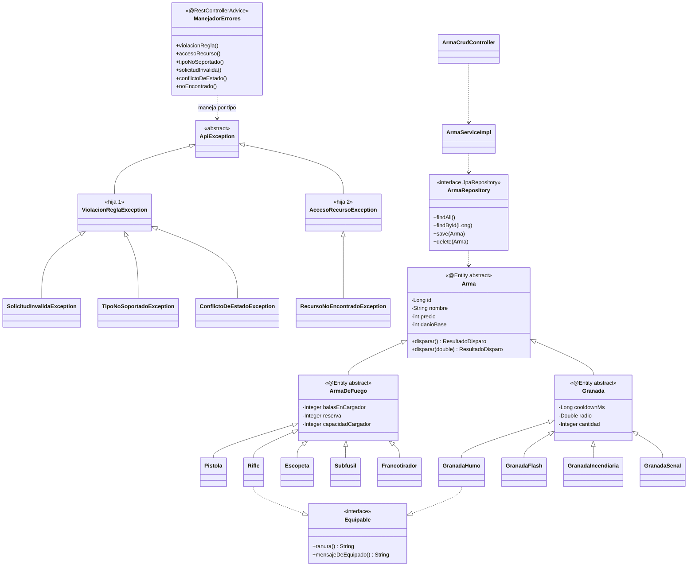

# Taller Git 2026 — Armas de Counter-Strike 2

Servicio HTTP (Spring Boot, API REST) que modela las armas de **Counter-Strike 2** con **persistencia en H2 + JPA**. 
Guarda el estado (munición/cooldown) entre peticiones y simula reglas de juego persistidas.

Materia: Lenguajes de Programación 3 — Taller de Git + POO.
Licencia: Apache License 2.0.

## Entrega

| Qué | Dónde |
|---|---|
| Commit de la solución | [`3bc471c`](https://github.com/luckvani-gif/vricciardi-tallerlp3-2026/commit/3bc471ca3ed4687f52c7b9ad5dff7c8a9290ea40) — *POO-08: persistencia H2, CRUD, jerarquía de excepciones, interface, Insomnia* |
| Código | `src/main/java/py/edu/uc/lp3` |
| Pruebas | `src/test/java/py/edu/uc/lp3/tp2026` (`mvn test`) |
| Bitácora de IA | [`BITACORA.md`](BITACORA.md) |
| Especificaciones | [`ESPECIFICACIONES.md`](ESPECIFICACIONES.md) |
| Colección Insomnia | [`insomnia/CS2-CRUD-Insomnia.json`](insomnia/CS2-CRUD-Insomnia.json) |

## Cómo arrancar

```bash
cd vricciardi-tallerlp3-2026
./mvnw spring-boot:run
```

Servicio: `http://localhost:8080`  
Consola H2: `http://localhost:8080/h2-console`

## Propiedades de H2 (explicadas)

`src/main/resources/application.properties`:

```properties
spring.application.name=vricciardi-tallerlp3-2026
spring.datasource.url=jdbc:h2:file:./data/cs2        # Base en archivo: persiste entre reinicios
spring.datasource.username=sa                       # Usuario por defecto de H2
spring.datasource.password=                         # Sin contraseña en desarrollo
spring.jpa.hibernate.ddl-auto=update               # Crea/actualiza esquema desde entidades JPA
spring.jpa.open-in-view=false                      # Evita lazy loading fuera de transacción
spring.h2.console.enabled=true                     # Habilita consola web
spring.h2.console.path=/h2-console                 # Ruta de la consola
```

En tests se usa `src/test/resources/application.properties` con `jdbc:h2:mem:lp3test` y `create-drop`.

## Organización de paquetes

```
py.edu.uc.lp3
├── constants        # ApiPaths, TiposArma
├── domain           # Entidades (Arma, ArmaDeFuego, Granada, hijas), Equipable (interface), records
├── exceptions       # Jerarquía: ApiException -> ViolacionReglaException, AccesoRecursoException
├── repository       # ArmaRepository (Spring Data JPA)
├── rest/controller  # ArmaCrudController, ManejadorErrores, ArmaController, IndexController
├── rest/dto         # ArmaRequest
└── service/impl     # Lógica de negocio y persistencia
```

## Tres clases del modelado que participan (persistidas)

Se persiste la **familia** con `@Inheritance(strategy = InheritanceType.SINGLE_TABLE)` y `@DiscriminatorColumn(name = "tipo_arma")`:

1. **`Arma`** (clase base, `@Entity`, abstracta) — atributos comunes, `id` generado, validaciones, Template Method `disparar()`.
2. **`ArmaDeFuego`** (hija 1, `@Entity`, abstracta) — generaliza munición (`capacidadCargador`, `balasEnCargador`, `reserva`). Implementa lógica final de recarga/consumo.
3. **`Granada`** (hija 2, `@Entity`, abstracta) — generaliza granadas (`cooldownMs`, `radio`, `cantidad`, `ultimoLanzamientoMs`). Lógica de cooldown.

Clases concretas: `Pistola`, `Subfusil`, `Rifle`, `Escopeta`, `Francotirador`, `GranadaHumo`, `GranadaFlash`, `GranadaIncendiaria`, `GranadaSenal`.

## Dos reglas de negocio que alimentan una simulación persistida

- **Regla 1 — Control de munición por disparo (persistida):** Al disparar un arma de fuego se consume una bala del cargador. Si no hay balas, el disparo falla con `ConflictoDeEstadoException` (409) y **el estado NO se corrompe ni se guarda de forma ilegal**; el estado actual se persiste solo tras un disparo exitoso.
- **Regla 2 — Carga de munición con control de reserva (persistida):** `POST /api/armas/{id}/recargar` recarga desde reserva solo si hay balas faltantes y hay reserva. Si el cargador está lleno o no hay reserva, lanza `ConflictoDeEstadoException` (409). Las granadas no son recargables. El resultado se persiste en H2.

## Jerarquía de excepciones (base + dos hijas) con handler por tipo

```text
ApiException (base, abstracta)
├── ViolacionReglaException (hija 1)  -> reglas/validación/tipo/cambio de tipo
│   ├── SolicitudInvalidaException    -> 400
│   ├── TipoNoSoportadoException      -> 400
│   └── ConflictoDeEstadoException    -> 409
└── AccesoRecursoException (hija 2)   -> acceso a recursos
    └── RecursoNoEncontradoException  -> 404
```

`ManejadorErrores` tiene `@ExceptionHandler` **por cada tipo** (`@RestControllerAdvice`). Los constructores del dominio también lanzan `IllegalArgumentException` y se traducen a `400`.

## Interface de dominio (POO-07)

`py.edu.uc.lp3.domain.Equipable` define `ranura()` y `mensajeDeEquipado()`. **Dos clases** lo implementan: `Rifle` y `GranadaHumo`. `GET /api/armas/equipables` trabaja con `List<Equipable>` leyendo desde el repositorio y muestra el mensaje polimórficamente.

## CRUD REST completo

| Método | Ruta | Descripción |
|---|---|---|
| POST | `/api/armas` | Crear (usa discriminador `tipo`, delega a constructor simple/sobrecargado). **201** + `id`. |
| GET | `/api/armas` | Listar todo desde `ArmaRepository`. |
| GET | `/api/armas/{id}` | Obtener uno. **404** si no existe. |
| PUT | `/api/armas/{id}` | Actualizar datos. **No permite cambiar tipo** → **409**. |
| DELETE | `/api/armas/{id}` | Eliminar. **204**. **404** si no existe. |
| POST | `/api/armas/{id}/disparar?distancia=10` | Simulación regla 1 (persistida). |
| POST | `/api/armas/{id}/recargar` | Simulación regla 2 (persistida). |
| GET | `/api/armas/equipables` | Endpoint de la **interface**. |

## Colección de Insomnia

Importar `insomnia/CS2-CRUD-Insomnia.json` en Insomnia. Incluye: entorno `base_url`, CRUD, **POST ilegal** (precio negativo / tipo desconocido / cargador incompleto), **PUT ilegal** (cambio de tipo), **id inexistente** (GET/DELETE), **endpoint de interface**, **simulación** y un pedido por cada excepción hija.

**Orden sugerido:** `GET /` → `POST /api/armas` (guardar id) → `GET /api/armas` → `GET /api/armas/{id}` → `PUT /api/armas/{id}` → `POST /api/armas/{id}/disparar` → `POST /api/armas/{id}/recargar` → `GET /api/armas/equipables` → probar errores → `DELETE /api/armas/{id}`. Al reiniciar con H2 archivo, lo guardado persiste.

## Diagrama Mermaid



## Pruebas

```bash
./mvnw test
```
**Resultado:** `BUILD SUCCESS` con **21 tests**.

## Respuestas a "Qué hay que pensar"

- **Recurso y verbo:** Recurso `armas` en `/api/armas`. El verbo HTTP define la acción (POST crear, GET leer, PUT actualizar, DELETE borrar). No se ponen verbos en la URL.
- **Identidad:** `id` con `@GeneratedValue` (generado por la base). El JSON de creación omite `id`.
- **Herencia y tablas:** `SINGLE_TABLE` con discriminador `tipo_arma`. Se guarda toda la familia en una tabla; JPA instancia el subtipo correcto. Se ven los tres niveles conceptuales (Arma/ArmaDeFuego/Granada) en código.
- **Interface y repositorio:** `ArmaRepository` es **interfaz** (Spring Data genera implementación) → desacoplamiento. `Equipable` es **interfaz de dominio** usada por `GET /api/armas/equipables` con objetos de familias distintas.
- **Ocultamiento:** validación en constructores, `@PrePersist/@PreUpdate`, reglas en servicio/dominio. `POST` ilegal → excepción → handler → **400/409**, sin dejar fila sucia.
- **PUT/PATCH:** Se usa **PUT** (reemplaza datos editables). Se **prohíbe cambiar el tipo** persistido → **409**.
- **DELETE:** Borrado físico con `delete`, responde **204**. Si no existe → **404** vía `AccesoRecursoException`.
