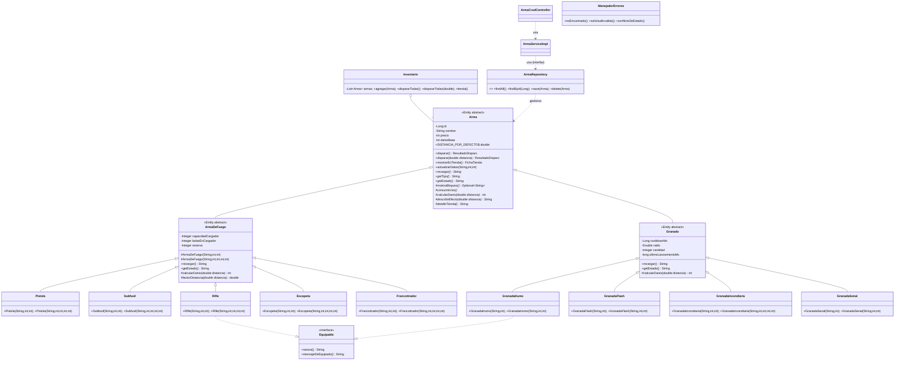

# Taller Git 2026 — Armas de Counter-Strike 2

Servicio HTTP (Spring Boot, API REST) que modela las armas de **Counter-Strike 2** aplicando
herencia, sobreescritura, ocultamiento de la información, **persistencia con H2 + JPA**,
**CRUD REST completo** y **colección Insomnia**.

Materia: Lenguajes de Programación 3 — Taller de Git + POO.
Licencia: Apache License 2.0.

## Entrega

| Qué | Dónde |
|---|---|
| Commit de la entrega | [`1f6c59f`](https://github.com/luckvani-gif/vricciardi-tallerlp3-2026/commit/1f6c59fefbcd15e4a3a7c436b1374ba828784545) — *POO-08: CRUD REST con H2, JPA, Insomnia y jerarquía persistida* |
| Código | `src/main/java/py/edu/uc/lp3` |
| Pruebas | `src/test/java/py/edu/uc/lp3/tp2026` (`mvn test`) |
| Bitácora de IA | [`BITACORA.md`](BITACORA.md) |
| Especificaciones | [`ESPECIFICACIONES.md`](ESPECIFICACIONES.md) |
| Colección Insomnia | [`insomnia/CS2-CRUD-Insomnia.json`](insomnia/CS2-CRUD-Insomnia.json) |
| Documentación | este `README.md` |

## Organización del código

La estructura sigue el **template del TP de LP3** (`domain` → `service` → `rest.controller`,
con `constants` para lo que se repite), con `repository` para la capa de persistencia
y `exceptions` para la jerarquía de errores.

```
src/main/java/py/edu/uc/lp3
├── Application.java                  @SpringBootApplication + @ComponentScan + @EnableJpaRepositories + @EntityScan
├── constants
│   ├── ApiPaths.java                 rutas de la API (BASE_API + "/armas", "/inventario", "/api/armas")
│   └── TiposArma.java                tipos válidos: pistola, subfusil, rifle, ..., granadas
├── domain                            el modelo: no sabe nada de Spring ni de HTTP
│   ├── Arma.java                     entidad base (@Entity, SINGLE_TABLE, @DiscriminatorColumn) + Template Method
│   ├── ArmaDeFuego.java              abstracta, generaliza la munición
│   ├── Granada.java                  abstracta, generaliza cantidad y cooldown
│   ├── Pistola, Subfusil, Rifle, Escopeta, Francotirador
│   ├── GranadaHumo, GranadaFlash, GranadaIncendiaria, GranadaSenal
│   ├── Equipable.java                interfaz de dominio (POO-07)
│   ├── Inventario.java               List<Arma>, dispara todas sin if/instanceof
│   ├── FichaTienda.java              record
│   ├── ResultadoDisparo.java         record
│   └── ResultadoRecarga.java         record
├── exceptions                        jerarquía: ApiException -> SolicitudInvalida/TipoNoSoportado, RecursoNoEncontrado, ConflictoDeEstado
├── repository                        interfaces Spring Data
│   └── ArmaRepository.java           JpaRepository<Arma,Long> + findByNombreContainingIgnoreCase
├── rest
│   ├── controller                   capa web: solo habla con los servicios
│   │   ├── IndexController.java
│   │   ├── ArmaController.java      catálogo POO-06 (GET /armas/{tipo})
│   │   ├── ArmaCrudController.java  CRUD /api/armas (POST/GET/PUT/DELETE + disparar/recargar + equipables)
│   │   ├── InventarioController.java
│   │   └── ManejadorErrores.java    @RestControllerAdvice: un handler por tipo de excepción
│   └── dto
│       └── ArmaRequest.java         discriminador "tipo" para crear la clase hija
└── service                           interfaz de servicio
    ├── ArmaService.java
    ├── InventarioService.java
    └── impl
        ├── ArmaServiceImpl.java      @Service: único lugar que elige el tipo concreto + CRUD persistente
        └── InventarioServiceImpl.java @Service: arma el inventario completo
```

## Dependencias y configuración H2

`pom.xml` incluye `spring-boot-starter-data-jpa` y `com.h2database:h2`. La configuración está en `src/main/resources/application.properties`:

```properties
spring.application.name=vricciardi-tallerlp3-2026
spring.datasource.url=jdbc:h2:file:./data/cs2        # archivo: persiste entre reinicios
spring.datasource.username=sa
spring.datasource.password=
spring.jpa.hibernate.ddl-auto=update                # crea/actualiza el esquema desde las entidades
spring.jpa.open-in-view=false
spring.h2.console.enabled=true
spring.h2.console.path=/h2-console
```

- **URL JDBC**: `jdbc:h2:file:./data/cs2` guarda las filas en `./data/cs2.mv.db`. Al reiniciar la app, lo guardado sigue ahí.
- **`ddl-auto=update`**: Hibernate genera/actualiza las tablas según `@Entity` (`armas` con `tipo_arma` discriminador).
- **Consola H2**: `http://localhost:8080/h2-console` (JDBC URL `jdbc:h2:file:./data/cs2`, usuario `sa`).

## Requisitos y ejecución

- Java 21
- Maven (incluido con `./mvnw`)

```bash
./mvnw spring-boot:run
# luego abrir http://localhost:8080/
# consola H2: http://localhost:8080/h2-console
```

## Endpoints

### CRUD persistido en H2 (`/api/armas`)
| Método | Ruta | Descripción |
|---|---|---|
| POST | `/api/armas` | Crea un arma persistida. Body: `{"tipo":"rifle","nombre":"AK-47","precio":2700,"danio":36,"cargador":30,"reserva":90"}`. Devuelve `201` con `id`. |
| GET | `/api/armas` | Lista todo lo persistido (lee desde el repositorio). Filtro opcional: `?nombre=ak` |
| GET | `/api/armas/{id}` | Lee uno. Si no existe → `404` |
| PUT | `/api/armas/{id}` | Reemplaza datos editables (`nombre`, `precio`, `danio`). No cambia el `tipo` persistido (`409` si se intenta). |
| DELETE | `/api/armas/{id}` | Elimina la fila. Responde `204`. Si no existe → `404` |
| POST | `/api/armas/{id}/disparar?distancia=10` | Simulación que modifica el estado persistido (balas/cooldown). |
| POST | `/api/armas/{id}/recargar` | Recarga si hay munición de reserva. |
| GET | `/api/armas/equipables` | Usa la **interfaz `Equipable`**: lista `Rifle` y `GranadaHumo` leídos desde H2. |

### Catálogo en memoria (POO-06)
| Método | Ruta | Descripción |
|---|---|---|
| GET | `/` | Información del servicio, tipos, endpoints y cantidad persistida |
| GET | `/armas/{tipo}` | Construye un arma con parámetros de la URL y la muestra en la tienda |
| GET | `/armas/{tipo}/disparar?veces=3` | Construye el arma y dispara N veces; sin `distancia` usa la sobrecarga |
| GET | `/inventario` | Tienda con un arma de cada tipo |
| GET | `/inventario/disparar?distancia=5&veces=2` | Cada arma del inventario dispara (polimorfismo) |

Tipos válidos: `pistola`, `subfusil`, `rifle`, `escopeta`, `francotirador`, `humo`, `flash`, `incendiaria`.

```bash
# CRUD
curl -X POST http://localhost:8080/api/armas -H 'Content-Type: application/json' -d '{"tipo":"rifle","nombre":"AK-47","precio":2700,"danio":36}'
curl http://localhost:8080/api/armas
curl http://localhost:8080/api/armas/1
curl -X PUT http://localhost:8080/api/armas/1 -H 'Content-Type: application/json' -d '{"tipo":"rifle","nombre":"AK-47 Redline","precio":3000,"danio":40}'
curl -X DELETE http://localhost:8080/api/armas/1
curl http://localhost:8080/api/armas/equipables

# Errores
curl -X POST http://localhost:8080/api/armas -H 'Content-Type: application/json' -d '{"tipo":"rifle","nombre":"AK","precio":-5,"danio":36}'
curl http://localhost:8080/api/armas/999999
```

## Jerarquía, herencia, sobrecarga y sobreescritura

### Herencia persistida
- **Clase base persistible**: `Arma` es `@Entity` con `@Inheritance(strategy = InheritanceType.SINGLE_TABLE)`, `@DiscriminatorColumn(name = "tipo_arma", discriminatorType = DiscriminatorType.STRING)`. Tiene constructor sin argumentos para JPA (con visibilidad `protected`) y **constructores de negocio** que validan invariantes.
- **Dos clases hijas independientes**: `ArmaDeFuego` y `Granada` extienden `Arma`. Cada una agrega `@Entity` + `@DiscriminatorValue`.
- **Cinco hijas de `ArmaDeFuego`**: `Pistola`, `Subfusil`, `Rifle`, `Escopeta`, `Francotirador`. **Tres hijas de `Granada`**: `GranadaHumo`, `GranadaFlash`, `GranadaIncendiaria` (más `GranadaSenal` agregada por el compañero). El discriminador permite distinguir el subtipo en la tabla y en el polimorfismo.
- **Método abstracto sigue existiendo**: `Arma` declara `getTipo()`, `getEstado()`, `recargar()`, `describirEfecto(double)`, `detalleTienda()`, `motivoBloqueo()`, `consumirUso()`, `calcularDanio(double)`. Las hijas lo **sobreescriben**.

### Protocolo de dominio (POO-07)
`Equipable` es una **interfaz** con `ranura()` y `mensajeDeEquipado()`. `Rifle` y `GranadaHumo` la implementan. El endpoint `GET /api/armas/equipables` trabaja con `List<Equipable>` y devuelve mensajes desde la interfaz (polimorfismo entre familias distintas).

### Repositorio y desacoplamiento
`ArmaRepository` extiende `JpaRepository<Arma, Long>`. Es una **interfaz**: Spring genera la implementación. `ArmaServiceImpl` depende de la interfaz del repositorio; el controller depende del servicio. El controller traduce HTTP, el repositorio traduce filas, las reglas viven en el dominio.

### Sobrecarga
- `Arma.disparar()` sobrecarga a `Arma.disparar(double)` (delegación, usa `DISTANCIA_POR_DEFECTO=10`)
- `Inventario.dispararTodas()` sobrecarga a `Inventario.dispararTodas(double)`
- Constructores: armas de fuego/granadas tienen **constructor simple** y **constructor sobrecargado**; el simple delega con `this(...)` al sobrecargado y este llama a `super(...)`. `ArmaServiceImpl` usa el constructor simple cuando no se pasa munición/cantidad, y el sobrecargado cuando se pasan.

### Sobreescritura
`ArmaDeFuego.factorDistancia(double)` es abstracto; cada hija lo implementa con su propia caída de daño. `Escopeta` redefine `describirEfecto`, `Francotirador` deja daño completo, granadas redefinen `describirEfecto`. `Inventario` usa `List<Arma>` sin `if` ni `instanceof`.

## Jerarquía de excepciones y handler por tipo
```
ApiException (abstracta)
├── SolicitudInvalidaException  (400)
│   └── TipoNoSoportadoException (400)
├── RecursoNoEncontradoException (404)
└── ConflictoDeEstadoException   (409)
```
`ManejadorErrores` tiene `@ExceptionHandler` por cada tipo (`@RestControllerAdvice`). También traduce `IllegalArgumentException` a `400`. Los constructores del dominio validan y lanzan `IllegalArgumentException`; el handler los mapea a `400` para mostrar que la regla se rompe antes de persistir.

## Colección Insomnia
Se incluye `insomnia/CS2-CRUD-Insomnia.json` con:
- Entorno con `base_url = http://localhost:8080`
- Peticiones para cada verbo CRUD
- Casos de error: `POST` con precio negativo, tipo desconocido, cargador incompleto; `GET/DELETE` con id inexistente
- Petición que usa la interfaz `Equipable` (`GET /api/armas/equipables`)
- Peticiones del catálogo POO-06

**Orden de ejecución:** `GET /` → `POST /api/armas` (guardar `id`) → `GET /api/armas` → `GET /api/armas/{id}` → `PUT /api/armas/{id}` → `POST /api/armas/{id}/disparar` → `GET /api/armas/equipables` → `DELETE /api/armas/{id}`. Probar también los errores.

## Diagrama de clases



**Diferencia entre relaciones:** `extends` = herencia; `..|>` = implementación de interfaz; `..>` / `o--` = uso/composición. `ArmaRepository` es interfaz (Spring Data genera la implementación).

## Decisiones de diseño

- **Ocultamiento:** atributos `private`. `Arma` tiene validación en constructores y `@PrePersist/@PreUpdate`. Constructor vacío `protected` para JPA.
- **Template Method:** `disparar()` es `final` en `Arma`. Flujo (validar → bloqueo → consumir → daño) común; hijas completan pasos.
- **Herencia + tablas:** `SINGLE_TABLE` con discriminador `tipo_arma` (una tabla `armas`, subtipos por discriminador).
- **Protocolo:** `Equipable` permite tratar armas/granadas equipables polimórficamente.
- **Repositorios:** Spring Data `JpaRepository` como interfaz; sin implementar `CRUD` a mano.
- **Excepciones:** jerarquía propia + handler por tipo → códigos HTTP correctos.
- **Fábrica:** `ArmaServiceImpl` único lugar para elegir tipo concreto.
- **Polimorfismo:** `Inventario` y `ArmaCrudController` trabajan con `Arma` sin `if`/`instanceof` en lógica de negocio.

## Pruebas

```bash
./mvnw test
```

**Resultado:** `BUILD SUCCESS` con **21 tests** (1 `Tp2026ApplicationTests` + 11 `SobrecargaSobreescrituraTests` + 9 `GranadaSenalTest` + 5 `ArmaCrudIntegrationTest`).
