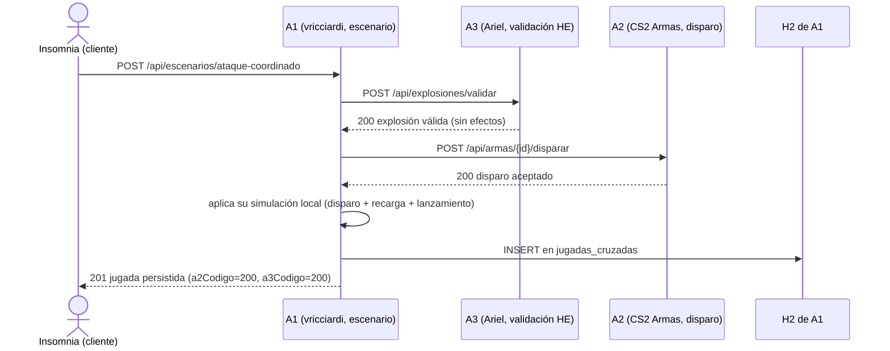
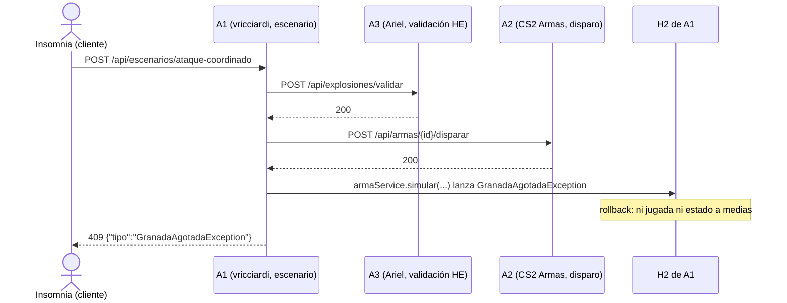
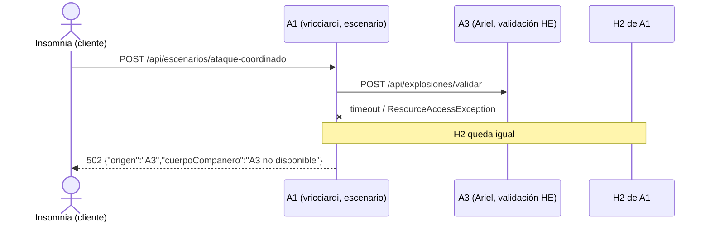

# POO-09 — Diagramas de secuencia (Mermaid)

Escenario: **ataque coordinado**. El cliente de Insomnia habla sólo con A1; A1 consulta las reglas de A3 y A2 y recién guarda en su H2 si ambas aceptan.

Orden elegido: **A3 primero** porque `POST /api/explosiones/validar` no detona ni modifica su base; **A2 después** porque `POST /api/armas/{id}/disparar` sí aplica el disparo en el H2 de A2. Si A3 rechaza, se evita gastar munición ajena.

## 1. Camino feliz — 201 (diagrama limpio)



## 2. Rechazo de A2 — 404

Ejemplo: `a2AtacanteId=999999` no existe en el catálogo de A2. A1 no escribe en su H2.

```mermaid
sequenceDiagram
    actor Cliente as Insomnia (cliente)
    participant A1 as A1 (vricciardi, escenario)
    participant A3 as A3 (Ariel, validación HE)
    participant A2 as A2 (CS2 Armas, disparo)
    participant H2 as H2 de A1

    Cliente->>A1: POST /api/escenarios/ataque-coordinado
    A1->>A3: POST /api/explosiones/validar
    A3-->>A1: 200 explosión válida
    A1->>A2: POST /api/armas/999999/disparar
    A2-->>A1: 404 id inexistente
    Note over A1,H2: no se llama a armaService.simular; H2 queda igual
    A1-->>Cliente: 404 {"origen":"A2","tipo":"RechazoCompaneroException"}
```

## 3. Rechazo de A3 — 409

Ejemplo: `a3GranadaId=6` ya está detonada en el servicio de Ariel. A2 no es llamado.

```mermaid
sequenceDiagram
    actor Cliente as Insomnia (cliente)
    participant A1 as A1 (vricciardi, escenario)
    participant A3 as A3 (Ariel, validación HE)
    participant A2 as A2 (CS2 Armas, disparo)
    participant H2 as H2 de A1

    Cliente->>A1: POST /api/escenarios/ataque-coordinado
    A1->>A3: POST /api/explosiones/validar
    A3-->>A1: 409 GranadaYaDetonadaException
    Note over A1,A2: A2 no es invocado
    Note over A1,H2: sin INSERT; H2 queda igual
    A1-->>Cliente: 409 {"origen":"A3","tipo":"RechazoCompaneroException"}
```

## 4. Regla propia de A1 — 409

Ambos compañeros aceptan, pero la simulación local falla (por ejemplo, la granada de A1 está agotada). La transacción se revierte.



## 5. Compañero no disponible — 502

El timeout se configura con `COMPANEROS_TIMEOUT` (5 s por defecto). El cuerpo conserva el `origen`.



## Tabla de códigos

| Situación | Código en A1 | `origen` | ¿H2 de A1 cambia? |
|---|---:|---|---|
| A2 y A3 aceptan | 201 | — | Sí: nueva fila en `jugadas_cruzadas` |
| A2 rechaza (id inexistente) | 404 | A2 | No |
| A3 rechaza (HE detonada) | 409 | A3 | No |
| Regla local falla | 409 | A1 | No (rollback) |
| Compañero sin respuesta | 502 | A2 o A3 | No |
